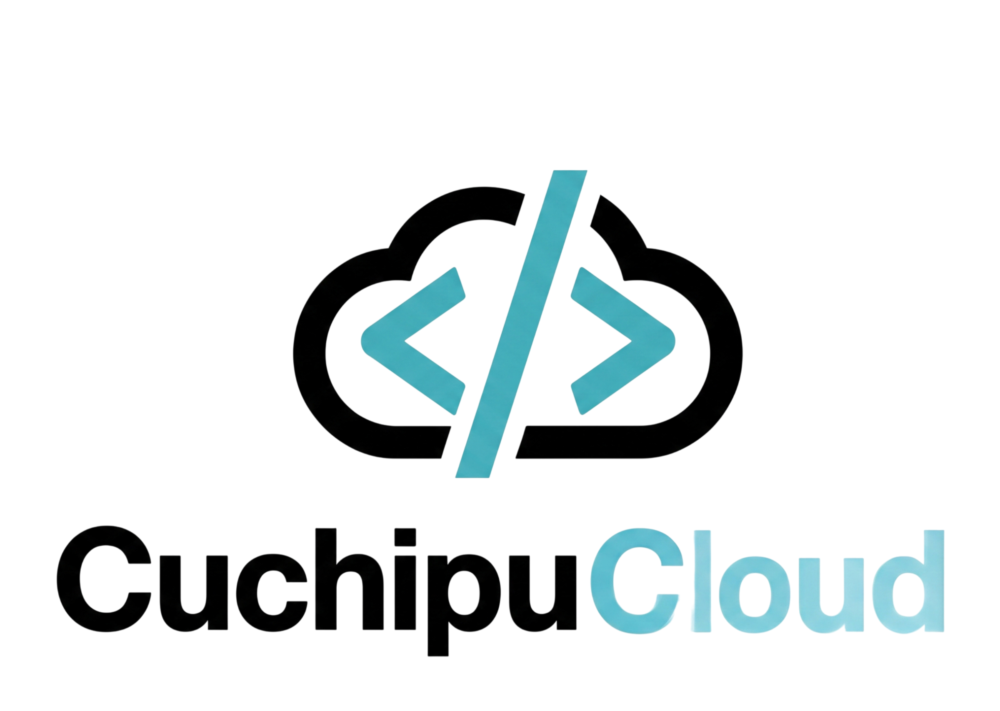

<div align="center">


# MediTec-ITS

**Sistema de gestión clínica y de enfermería**

Odontología · Nutrición · Administración · Portal del paciente


</div>

---

## ¿Qué es?


MediTec-ITS digitaliza la -operación de una clínica institucional: expedientes
clínicos, consultas, citas, planes alimenticios, horarios del personal,
inventario de medicamentos y reportes. Cada tipo de usuario tiene un panel
propio diseñado para su trabajo diario, incluyendo un portal donde los
pacientes consultan su información y gestionan sus citas.

## Tecnologías

| Capa | Tecnologías |
|---|---|
| **Frontend** | Astro · React · TypeScript · Tailwind CSS v4 · Lucide (iconos) · jsPDF (reportes) |
| **Backend** | Node/Bun · Express · mysql2 (SQL nativo, sin ORM) |
| **Base de datos** | MySQL 8.0 · Docker |
| **Calidad** | TypeScript estricto · design system propio · accesibilidad (ARIA, foco visible, `prefers-reduced-motion`) |

## Arquitectura

```
MediTec-ITS/
├── frontend/          Aplicación web (Astro + React + Tailwind)
│   └── src/components/
│       ├── ui/           Design system (botones, tarjetas, tablas, formularios…)
│       ├── layout/       Shell con sidebar colapsable y barra superior
│       ├── clinica/      Panel de odontología
│       ├── nutricion/    Panel de nutrición
│       ├── administrador/ Panel administrativo
│       ├── paciente/     Portal del paciente
│       └── sesion/       Login
├── backend/           API REST en Express sobre Bun
├── database/          init.sql — esquema completo (19 tablas, MySQL)
└── docker-compose.yml Servicio MySQL 8.0
```

Los cuatro paneles comparten un **design system** con paleta azul institucional,
mismos controles y patrones de interacción, de modo que cualquier mejora visual
o de accesibilidad aplica a todo el sistema. La base de datos está **normalizada**
con catálogos, expedientes, operación clínica y tablas puente; el backend
consume SQL directo (sin ORM) y expone respuestas en español.

## Cómo funciona la aplicación

- **Atención médica (`/`)** — el personal atiende el día: indicadores y agenda,
  **nueva consulta** con alertas de alergias y signos vitales, gestión de
  **citas** (agendar, confirmar, cancelar), control de **pacientes** y su
  **historial clínico** completo por expediente.
- **Nutrición (`/nutricion`)** — planes alimenticios por paciente: creación,
  vigencia (calorías, periodo, dieta) e historial nutricional.
- **Administración (`/admin`)** — roles, usuarios, **horarios en calendario
  semanal** con turnos compartidos, inventario de medicamentos con alertas de
  stock y **reportes con descarga en PDF**.
- **Portal del paciente (`/paciente`)** — cada paciente ve su expediente,
  completa su **cuestionario de salud inicial**, agenda citas en odontología o
  nutrición y consulta su historial de citas.

**Flujo general:** el paciente ingresa con su número de control → agendar cita →
el personal la confirma → registra la consulta sobre esa cita (o una urgencia) →
el expediente y el historial se actualizan para todas las áreas → los datos
alimentan indicadores y reportes.

## Impacto

- **Expediente digital único**: toda área consulta la misma información del
  paciente, sin papeles ni búsquedas manuales.
- **Seguridad clínica**: alergias y enfermedades crónicas aparecen como alerta
  en cada momento de atención.
- **Coordinación entre áreas**: odontología y nutrición comparten pacientes e
  historial; administración sostiene la operación (personal, horarios, inventario).
- **Participación del paciente**: agenda sus citas, actualiza sus datos y
  aporta su cuestionario de salud, reduciendo tiempos de espera.
- **Toma de decisiones**: indicadores y reportes exportables en PDF sobre la
  actividad real de la clínica.
- **Base para crecer**: esquema normalizado y API lista para autenticación,
  más áreas de especialidad y nuevos reportes.

---

<div align="center">



*Sistema de Gestión de Enfermería MediTec-ITS · 2026*

</div>
